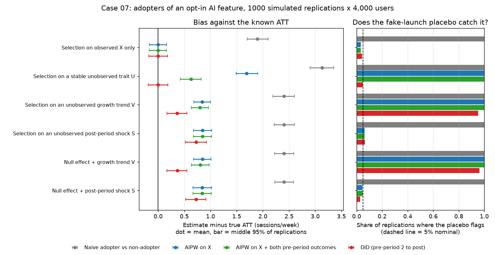

# Case Study 07: Opt-in AI Feature Adoption

**Method:** Monte Carlo with known ground truth, comparing naive, AIPW, and difference-in-differences estimates, each with a fake-launch placebo and an E-value.
**Question:** *We launched an opt-in AI writing assistant, and adopters look more engaged than non-adopters. Can we act on an observational estimate of the feature's effect, or do we need a randomized holdout or rollout?*



## TL;DR

Observational estimates were usable only when whatever drove adoption also showed up in the pre-launch outcomes. A fake-launch placebo caught selection on a stable trait and on a pre-existing growth trend. It was blind to the case that matters most for AI tools: users who opt in *because* their need is rising at the same time. There, every estimator was biased by +0.724 to +0.844 sessions/week against a true ATT of 1.243. With a true effect of zero, the gated rule below still acted on a spurious effect in 95.3% to 97.2% of replications. If that channel is plausible, run a holdout.

All numbers below are quoted from [`results.md`](results.md), which the reproducer writes.

## Business framing

Opt-in AI features (writing assistants, copilots, summarizers) are usually launched to everyone and adopted by whoever wants them. The first dashboard compares adopters with non-adopters, and the gap is large. Three separate questions hide inside that gap:

1. **Who adopts?** Heavier, more tenured users. That is observable and adjustable.
2. **Who are they beyond what we log?** Power users, or users already on an upswing. That is unobserved, but it may leave a footprint in pre-launch engagement.
3. **When do they adopt?** Often when they have a writing-heavy week coming. That is unobserved and leaves *no* footprint before launch.

The decision is whether to report the adjusted observational estimate as the feature's impact (and use it for roadmap and headcount calls) or to pay for a randomized holdout.

## Simulation

Each replication draws 4,000 users with three periods of weekly sessions: two pre-launch periods and one post-launch period. See [`src/adoption_simulate.py`](src/adoption_simulate.py) for the exact model.

- Observed covariates: tenure and prior activity.
- Adoption is logistic in tenure and activity, plus one unobserved channel per scenario.
- The effect is heterogeneous: users with higher prior activity gain more. Because they also adopt more, the **true ATT (1.283 sessions/week in `observables`) exceeds the true ATE (1.000)**. Even an unbiased adopter estimate overstates what forcing the feature on everyone would deliver.

| Scenario | Unobserved selection channel | Visible before launch? |
|---|---|---|
| `observables` | None | n/a |
| `fixed_trait` | Stable "power user" trait U, which raises engagement in every period | Yes, as a level |
| `pre_trend` | User-specific growth trend V, already present before launch | Yes, as a slope |
| `post_shock` | Shock S that raises engagement only after launch (for example, a new writing-heavy project) | No |
| `null_pre_trend`, `null_post_shock` | Same as above with a true effect of zero | |

Estimators, all compared with the true ATT:

- **Naive:** adopter mean minus non-adopter mean.
- **AIPW on X:** doubly robust ATT, reusing `psm.estimate_propensity` from [case 04](../04-propensity-score/).
- **AIPW on X plus both pre-period outcomes.**
- **DiD:** change from the last pre-period to the post-period. This uses the same estimand as `did.did_2x2` in [case 03](../03-diff-in-diff/) (a test checks that they agree).

Diagnostics:

- **Fake-launch placebo.** Each estimator is run one period earlier, as if the launch had happened between the two pre-periods. The true effect there is zero, so a significant placebo estimate flags bias.
- **E-value** (VanderWeele and Ding), from `sensitivity.e_value` in case 04.

## Results (1,000 replications per scenario, seed 0)

**Bias against the true ATT (sessions/week):**

| Scenario | Naive | AIPW on X | AIPW on X + pre | DiD |
|---|---|---|---|---|
| `observables` | +1.898 | -0.001 | -0.001 | +0.001 |
| `fixed_trait` | +3.129 | +1.690 | +0.628 | -0.001 |
| `pre_trend` | +2.402 | +0.841 | +0.799 | +0.360 |
| `post_shock` | +2.401 | +0.844 | +0.844 | +0.724 |

**Placebo flag rate:**

| Scenario | Naive | AIPW on X | AIPW on X + pre | DiD |
|---|---|---|---|---|
| `observables` | 100.0% | 3.3% | 3.2% | 4.4% |
| `fixed_trait` | 100.0% | 100.0% | 100.0% | 4.7% |
| `pre_trend` | 100.0% | 100.0% | 100.0% | 95.3% |
| `post_shock` | 100.0% | 6.2% | 6.2% | 6.5% |

What the numbers support:

1. **The naive gap is never usable.** Its bias (+1.9 to +3.1) is larger than the effect itself.
2. **With selection on observables, AIPW and DiD both work.** Bias is within ±0.001, and coverage is 95.1% to 96.4%.
3. **Putting pre-period outcomes in the adjustment set is not enough on its own.** In `fixed_trait`, AIPW with both pre-period outcomes still had +0.628 bias, because noisy pre-period outcomes only partly proxy the trait. DiD removed it (bias -0.001, coverage 94.8%). The placebo told them apart: it flagged AIPW with pre-period outcomes in 100.0% of replications and DiD in 4.7%.
4. **The placebo catches a pre-existing trend.** In `pre_trend`, DiD was biased by +0.360 (coverage 4.0%), and its placebo flagged in 95.3% of replications.
5. **The placebo is blind to a post-launch shock.** In `post_shock`, every estimator was biased (+0.724 to +0.844, coverage 0.0%), while placebo flag rates stayed near nominal (6.2% to 6.5%).
6. **The E-value is not a bias detector.** A spurious DiD estimate in `null_post_shock` had a median E-value of 1.83 (1.65 for the CI). Biased estimates have *larger* E-values than unbiased ones, because the bias inflates the estimate (naive in `observables`: 5.11, versus 2.42 for DiD). An E-value is only meaningful against an explicit bound on how strong an unmeasured driver could be.

**Gated rule: act only if the estimator's placebo passes and its CI excludes zero.** Each cell shows the share of replications where the gate says act, then the share where it acts on a CI that misses the truth. Quoted for DiD and AIPW on X plus pre-period outcomes:

| Scenario | AIPW on X + pre | DiD |
|---|---|---|
| `observables` | 96.8% / 4.3% | 95.6% / 3.0% |
| `fixed_trait` | 0.0% / 0.0% | 95.3% / 4.1% |
| `pre_trend` | 0.0% / 0.0% | 4.7% / 4.7% |
| `post_shock` | 93.8% / 93.8% | 93.5% / 93.5% |
| `null_pre_trend` | 0.1% / 0.1% | 3.9% / 3.9% |
| `null_post_shock` | 95.3% / 95.3% | 97.2% / 97.2% |

## Decision rule

An observational estimate of an opt-in AI feature's effect is usable only when all of the following hold:

1. **It uses pre-period outcomes.** Prefer DiD or another estimator that differences out stable traits. Never use the raw adopter gap.
2. **That estimator's own fake-launch placebo passes.** If it flags, the estimate is biased by selection that the placebo can see (a trend or a residual level difference). In `pre_trend`, the gate acted on DiD in only 4.7% of replications, although DiD rejected zero in 100.0%.
3. **You can argue that adoption is not timed to a change in need.** The placebo cannot test this. If users plausibly opt in when their workload rises, run a randomized holdout or a randomized staggered rollout instead.
4. **The E-value is reported against an explicit bound.** State how strongly a post-launch driver of both adoption and engagement could plausibly act, and compare it with the CI E-value. Do not treat a "large" E-value as a pass.

For a writing assistant, condition 3 is the weak link. Wanting help with writing is the reason to opt in, so a randomized holdout is the default, and an observational estimate is a screening number.

## How to reproduce

From the repository root:

```bash
python case-studies/07-ai-feature-adoption/src/run.py
```

This takes a few minutes. It uses a fixed seed (0) and rewrites [`results.md`](results.md) and [`docs/hero.png`](docs/hero.png). Known-answer tests in [`tests/test_adoption.py`](../../tests/test_adoption.py) check:

- the AIPW and DiD implementations agree with cases 04 and 03;
- the adjusted estimators are unbiased in `observables`;
- DiD is unbiased and the placebo catches AIPW in `fixed_trait`;
- the bias is upward and the placebo flags it in `pre_trend`;
- the placebo stays quiet while the bias is large in `post_shock`.

## Limitations

- **Linear trends.** The trend in `pre_trend` is linear, so the pre-launch slope predicts the post-launch slope. A trend that bends at launch behaves like `post_shock`.
- **Two pre-periods.** One placebo is a weak check. More pre-periods would allow an event-study test of trends, but it would still not see a post-launch shock.
- **One effect size per scenario.** The selection strengths are fixed. The direction of each result follows from the mechanism, but the bias sizes and flag rates do not transfer to other strengths or sample sizes.
- **Linear outcome model and logistic propensity.** These are correctly specified for observables here. Real data adds misspecification on top.
- **AIPW standard errors** treat the fitted nuisance models as fixed. Here they are calibrated (mean SE 0.085 against an empirical SD of 0.086 in `observables`), but cross-fitting would be safer with flexible models.

## References

- VanderWeele, T., and Ding, P. (2017). *Sensitivity Analysis in Observational Research: Introducing the E-value.* Annals of Internal Medicine.
- Angrist, J., and Pischke, J.-S. (2009). *Mostly Harmless Econometrics*, section 5.4, on bracketing between fixed effects and lagged dependent variables.
- Imbens, G., and Wooldridge, J. (2009). *Recent Developments in the Econometrics of Program Evaluation.* Journal of Economic Literature.
- Ashenfelter, O. (1978). *Estimating the Effect of Training Programs on Earnings.* Review of Economics and Statistics.
