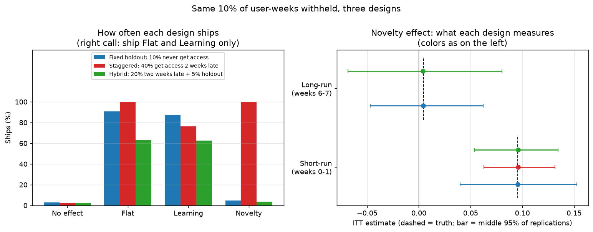

# Case 08: Staggered rollout vs fixed holdout for an opt-in AI feature

**Question:** [Case 07](../07-ai-feature-adoption/) concluded that an opt-in AI feature should be
measured with a randomized holdout or a staggered rollout, not an adopter comparison. Which of
the two should a team run when withheld traffic is the budget, and what does each one estimate
when the effect grows (learning) or fades (novelty)?

**Essay:** [A staggered rollout can't see novelty](https://github.com/wavde/wavde/blob/main/writing/staggered-rollout-vs-holdout.md)

**Method:** a simulation with known short-run and long-run effects. It compares three designs
that withhold the same 10% of post-launch user-weeks, using CUPED-adjusted intent-to-treat
contrasts.



## TL;DR

All numbers are from [`results.md`](results.md): 1,000 replications of 10,000 users per cell.

- **A staggered rollout answers the short-run question very precisely, and only that
  question.** Delaying 40% of users by 2 weeks gives a short-run SE of 0.0175, against 0.0285
  for a 10% fixed holdout. But nobody is untreated in weeks 6–7, so the long-run effect isn't
  identified.
- **That makes a staggered rollout ship novelty effects.** When the effect starts at 0.40 per
  adopter and fades 40% a week, the true short-run ITT is +0.0957 and the long-run ITT is
  +0.0045. The staggered rollout's short-run read ships it in 100.0% of replications. The fixed
  holdout reads the long run and ships it in 4.7%.
- **At equal cost, the fixed holdout made the best launch decision.**
  - It shipped a flat effect 90.9% of the time and a growing (learning) effect 87.5% of the time.
  - It shipped no effect 2.9% of the time and the novelty effect 4.7%.
  - Its shape test flagged the novelty decline 76.7% of the time.
- **The hybrid design (20% two weeks late plus a 5% holdout) is not a free lunch.** It gets a
  precise early read (short-run SE 0.0198) but a weaker long-run read: it ships a flat effect
  only 63.1% of the time and flags novelty 50.5% of the time.

**Decision rule.** If the launch decision depends on the long-run effect, which it does for
any feature with a plausible novelty or learning curve, keep a fixed holdout for the whole
window. A staggered rollout alone can't distinguish novelty from a lasting effect. Use the
hybrid only when an early readout is worth roughly a third of the long-run power.

## Design

- **Users:** each user has a stable effect `a_i` (SD 1.5), weekly noise SD 1, and a common
  weekly shock. There are 4 pre-launch and 8 post-launch weeks.
- **Opt-in:** with access, users adopt with a probability that rises with `a_i`, so heavier
  users adopt more, as in case 07. The adoption rate is in `results.md`.
- **Effect:** adopters gain `tau(d)` in week `d` after access. There are four shapes: none,
  flat, learning (grows toward 0.30) and novelty (starts at 0.40 and fades 40% a week).
- **Estimands:**
  - the short-run ITT (weeks 0–1 after launch);
  - the long-run ITT (weeks 6–7);
  - their difference, the "shape". The test for it is a DiD of late-minus-early windows between
    users with access since launch and holdout users.
- **Designs:** all three withhold 10% of post-launch user-weeks.
  - fixed holdout: 10% never get access;
  - staggered: 40% get access 2 weeks late;
  - hybrid: 20% two weeks late plus a 5% holdout.
- **Truth:** access is randomized, so the true ITT at duration `d` is `E[adopt] × tau(d)`. The
  adoption rate is computed by numerical integration. Code is in [`src/rollout.py`](src/rollout.py).

## Reproduce

```bash
pip install -r requirements.txt
python case-studies/08-rollout-vs-holdout/src/run.py
```

This uses seed `20261127` and takes about a minute. Two runs produce byte-identical
`results.md`. CI runs `--smoke`. Tests are in [`tests/test_rollout.py`](../../tests/test_rollout.py).

## Limitations

1. **Synthetic, with one effect shape at a time.** Real features can mix learning and novelty,
   and adoption itself can grow over weeks. Here adoption happens at access.
2. **No interference.** Users with access don't affect users without it. Collaborative or
   network features would violate this, and a holdout or delayed group would see spillover.
3. **Eight weeks is the "long run".** Effects that keep changing after week 8 need a longer
   holdout, and the cost of a holdout grows with its length.
4. **The ship rule is a single significance test.** Teams that ship on a short-run read plus
   a planned long-run check would make fewer novelty mistakes than the staggered row shows.
5. **Equal-cost comparison at one budget (10%).** Larger budgets raise every design's power.
   The ranking for the long-run decision follows from where each design spends its withheld
   user-weeks.
